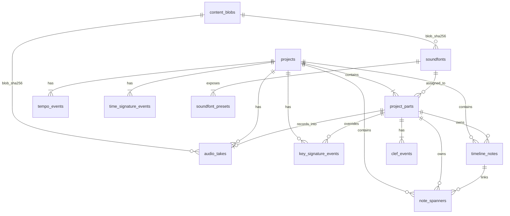

# Database & Content-Addressed Storage Specification — MuseGrid

This document defines MuseGrid's **SQLite relational schema (`musegrid.db`)** and **Content-Addressed Storage (CAS)** layout, aligned with [ARCHITECTURE.md](file:///Users/goldenfung/Documents/muse_grid/ARCHITECTURE.md) and [requirements.md](file:///Users/goldenfung/Documents/muse_grid/requirements.md).

MuseGrid persists project state using **authoritative local SQLite CRUD + immutable SHA-256 content-addressed files** so:
* Relational SQLite tables are the **single source of truth** for score notation and timing (`timeline_notes`, `note_spanners`, `key_signature_events`, `clef_events`, `tempo_events`, `time_signature_events`); MusicXML is used strictly for **import and export**, not stored as a CAS snapshot.
* Piano Roll and staff edits commit as $O(1)$ indexed row updates rather than re-serializing JSON or copying audio takes.
* Recorded raw WAV takes are finalized in `staging/`, hashed sequentially, and promoted once into CAS without copying or recompressing on save.
* Local tables preserve cheap future-sync invariants (`UUIDv7` keys, `revision` counters, `updated_at` timestamps, and top-level `deleted_at` tombstones), while dedicated cloud sync tables/columns (`sync_cursors`, `sync_status`) are deferred until the remote sync adapter is designed.

---

## 1. On-Disk & OPFS Directory Layout

* **Native Root:** `ApplicationSupportDirectory` (via `path_provider`, with iOS `NSURLIsExcludedFromBackupKey = true` on `cas/`). Both `staging/` and `cas/` live inside `ApplicationSupportDirectory` so they share the same filesystem volume (guaranteeing atomic `rename()`) and in-flight recordings are never purged by OS cache cleaners.
* **Web Root:** Browser **OPFS** (`navigator.storage.getDirectory()`), accessed synchronously inside a Web Worker via `FileSystemSyncAccessHandle` and `sqlite3.wasm` OPFS VFS.

```text
<Storage Root (ApplicationSupportDirectory | OPFS Root)>/
├── db/
│   ├── musegrid.db                        # Primary SQLite database
│   ├── musegrid.db-wal                    # Write-Ahead Log (Native only)
│   └── musegrid.db-shm                    # Shared memory index (Native only)
├── cas/                                   # Immutable Content-Addressed Store (2-hex shard)
│   ├── a1/
│   │   └── a1b2c3...9f.sf2                # SoundFont binary (deduplicated across projects)
│   └── d4/
│       └── d4e5f6...1a.wav                # Recorded raw WAV audio take (written once)
└── staging/                               # Native ApplicationSupport/staging | Web OPFS /staging
    └── rec_<take_id>.wav.part             # Active recording before finalize + hash + promote
```

### Recording & Import Write Flow (Finalize-Then-Hash)
1. **Encode & Finalize:** During recording, the Butler worker encodes `CaptureRingBuffer` frames as raw WAV (`ma_encoding_format_wav` via `ma_encoder`) into `staging/rec_<take_id>.wav.part`. On `stop()`, `ma_encoder_uninit()` patches the final RIFF/`data` chunk sizes in the WAV header.
2. **Compute Digest:** After WAV finalization, the worker computes the lowercase SHA-256 digest in a sequential read over the finalized file. *(External `.sf2` imports are already finalized and may compute SHA-256 in a single streaming pass while copying into `staging/`.)*
3. **Bridge Handoff & Promote (`lib/storage/`):** The Butler worker returns `{stagingPath, sha256, durationFrames, sampleRate, channelCount, capturedPlayheadFrame, capturedSampleClock, outputBufferFrames, inputBufferFrames}` across `IRecordingBridge` to the Dart storage adapter (`lib/storage/`). `lib/storage/` checks whether `cas/<aa>/<sha256>.<ext>` already exists (deduplication), promotes the staging file (atomic POSIX `rename()` on Native; OPFS `FileSystemHandle.move()` where supported or verified copy-and-unlink on Web), and deletes any duplicate staging file.
4. **Transactional Commit:** `lib/storage/` inserts `content_blobs` (`INSERT OR IGNORE`) and inserts/overwrites (`UPSERT` on `(project_id, part_id)`) the referencing `audio_takes` or inserts `soundfonts` row inside a single SQLite `BEGIN IMMEDIATE ... COMMIT` transaction. Superseded `.wav` blobs are reclaimed on the next Mark-and-Sweep GC pass.

---

## 2. Entity-Relationship Model



---

## 3. SQLite Connection Pragmas & Conventions

All SQLite writes run through the single platform storage connection owned by `lib/storage/`.

* **Common Pragmas (Native & Web):**
  ```sql
  PRAGMA foreign_keys = ON;
  PRAGMA busy_timeout = <kSqliteBusyTimeoutMs>; -- Centralized storage constant
  ```
* **Platform Journal Mode (Verify on Open, Fail Closed):**
  * **Native (`sqlite3` FFI):** Initialize with `PRAGMA journal_mode = WAL;` and `PRAGMA synchronous = NORMAL;`.
  * **Web (`sqlite3.wasm` over OPFS VFS):** Uses SQLite's default rollback journal (`DELETE` / `TRUNCATE`) because OPFS `FileSystemSyncAccessHandle` lacks multi-process shared-memory mapping required by WAL. Never issue `PRAGMA journal_mode = WAL` on Web.
  * On both platforms, query `PRAGMA journal_mode;` after initialization and fail closed if the active mode does not match the platform expectation.
* **Strict Typing & Range Constraints:** All tables use SQLite `STRICT` mode plus explicit `CHECK` constraints so invalid musical or storage rows fail loudly on write.
* **Primary Keys:** Client-generated **`UUIDv7` (`TEXT`)** across all entity tables (including `project_parts`) for global uniqueness and chronological index locality.
* **Timestamps:** Unix epoch milliseconds (`INTEGER`, UTC).
* **Soft Delete & FK Consistency:** Top-level user-managed entities (`projects`, `soundfonts`) carry nullable `deleted_at` tombstones. Child score/map tables (`project_parts`, `tempo_events`, `time_signature_events`, `key_signature_events`, `clef_events`, `timeline_notes`, `note_spanners`, `audio_takes`) do **not** keep separate partial tombstones—`audio_takes` enforces one overwrite recording per part (`UNIQUE (project_id, part_id)`), supports undoable removal/overwrite via `ScoreMutationBatch`, and all child rows are hidden whenever their parent `projects.deleted_at IS NOT NULL` and removed via `ON DELETE CASCADE` on project purge.
* **Deferred Cloud Sync Fields:** `sync_cursors` and `content_blobs.sync_status` are deferred until the future cloud sync adapter (`lib/storage/cloud/`) is designed.
* **Exact Segment-Wise Integer Timing Invariant:** Musical ticks use canonical **`960 PPQN`** (`1 Whole = 3840` ticks) and tempo uses exact integer **`us_per_quarter`**. Rather than accumulating a fractional per-tick ratio, L4 converts `tick` → `sampleFrame` per constant-tempo segment with a single 64-bit integer division/rounding per segment (splitting ultra-long constant-tempo segments if needed so `(tick - segStartTick) * us_per_quarter * sampleRate` never overflows signed 64-bit integers; Web dart2js targets must guard 53-bit JS numbers with `BigInt` if not compiled via `--wasm`):

$$\text{frame} = \text{segStartFrame} + \left\lfloor \frac{(\text{tick} - \text{segStartTick}) \times \text{us\_per\_quarter} \times \text{sampleRate}}{960 \times 1\,000\,000} \right\rfloor$$

---

## 4. Complete SQLite Schema (`musegrid.db`)

### 4.1 Schema Versioning

```sql
CREATE TABLE schema_migrations (
    version     INTEGER PRIMARY KEY CHECK (version > 0),
    applied_at  INTEGER NOT NULL
) STRICT;
```

### 4.2 Content-Addressed Binary Registry (`content_blobs`)

Tracks every immutable `.sf2` and `.wav` file in `cas/`. The relative CAS path (`cas/<substr(sha256, 1, 2)>/<sha256>.<ext>`) is derived deterministically from `sha256` and `ext` rather than stored redundantly. Garbage collection uses mark-and-sweep (Section 5) rather than application-managed reference counting.

```sql
CREATE TABLE content_blobs (
    sha256      TEXT PRIMARY KEY CHECK (length(sha256) = 64), -- 64-char lowercase hex SHA-256
    ext         TEXT NOT NULL CHECK (ext IN ('sf2', 'wav')),
    mime_type   TEXT NOT NULL,
    byte_size   INTEGER NOT NULL CHECK (byte_size > 0),
    created_at  INTEGER NOT NULL
) STRICT;
```

### 4.3 Projects, Parts, & Timeline / Engraving Maps

* `project_parts` uses a `UUIDv7` `part_id` primary key (immune to MusicXML `<score-part id="...">` renumbering on re-import), alongside `UNIQUE (project_id, part_id)` for composite foreign-key integrity from child tables.
* Each part may hold notation (`timeline_notes`), recorded audio (`audio_takes`), or both. An audio-only track may leave `sf_id = NULL`, whereas triggering MIDI playback on a part that has `timeline_notes` and `sf_id IS NULL` fails closed with `MISSING_SOUNDFONT`.
* Derived UI fields (`bpm_display`, `measure_index`) are computed in L4 rather than stored in SQLite.

```sql
CREATE TABLE projects (
    project_id            TEXT PRIMARY KEY,      -- UUIDv7
    title                 TEXT NOT NULL,
    ppqn                  INTEGER NOT NULL CHECK (ppqn = 960),
    grid_snap_ticks       INTEGER NOT NULL CHECK (grid_snap_ticks > 0),
    pickup_ticks          INTEGER NOT NULL DEFAULT 0 CHECK (pickup_ticks >= 0), -- Anacrusis offset
    playback_timing_mode  TEXT NOT NULL DEFAULT 'quantized' CHECK (playback_timing_mode IN ('quantized', 'raw')),
    revision              INTEGER NOT NULL CHECK (revision >= 0),
    created_at            INTEGER NOT NULL,
    updated_at            INTEGER NOT NULL,
    deleted_at            INTEGER                -- NULL unless soft-deleted
) STRICT;

CREATE INDEX idx_projects_active
    ON projects(updated_at DESC)
    WHERE deleted_at IS NULL;

CREATE TABLE project_parts (
    part_id           TEXT PRIMARY KEY,          -- UUIDv7
    project_id        TEXT NOT NULL REFERENCES projects(project_id) ON DELETE CASCADE,
    musicxml_part_id  TEXT NOT NULL,             -- Last imported/exported MusicXML <score-part id>
    sort_order        INTEGER NOT NULL CHECK (sort_order >= 0),
    name              TEXT NOT NULL,
    staves_count      INTEGER NOT NULL CHECK (staves_count IN (1, 2)), -- 1 = single staff, 2 = grand staff
    midi_channel      INTEGER NOT NULL CHECK (midi_channel BETWEEN 0 AND 15),
    sf_id             TEXT REFERENCES soundfonts(sf_id) ON DELETE SET NULL,
    bank_num          INTEGER NOT NULL CHECK (bank_num >= 0),
    program_num       INTEGER NOT NULL CHECK (program_num BETWEEN 0 AND 127),
    gain_db           REAL NOT NULL,
    pan               REAL NOT NULL CHECK (pan BETWEEN -1.0 AND 1.0),
    is_muted          INTEGER NOT NULL CHECK (is_muted IN (0, 1)),
    is_solo           INTEGER NOT NULL CHECK (is_solo IN (0, 1)),
    updated_at        INTEGER NOT NULL,
    UNIQUE (project_id, part_id),
    UNIQUE (project_id, musicxml_part_id)
) STRICT;

CREATE TABLE tempo_events (
    tempo_event_id  TEXT PRIMARY KEY,            -- UUIDv7
    project_id      TEXT NOT NULL REFERENCES projects(project_id) ON DELETE CASCADE,
    tick            INTEGER NOT NULL CHECK (tick >= 0), -- tick 0 = initial tempo
    us_per_quarter  INTEGER NOT NULL CHECK (us_per_quarter > 0),
    updated_at      INTEGER NOT NULL,
    UNIQUE (project_id, tick)
) STRICT;

CREATE TABLE time_signature_events (
    ts_event_id  TEXT PRIMARY KEY,               -- UUIDv7
    project_id   TEXT NOT NULL REFERENCES projects(project_id) ON DELETE CASCADE,
    tick         INTEGER NOT NULL CHECK (tick >= 0), -- Measure-aligned tick
    numerator    INTEGER NOT NULL CHECK (numerator > 0),
    denominator  INTEGER NOT NULL CHECK (denominator IN (1, 2, 4, 8, 16, 32, 64)),
    updated_at   INTEGER NOT NULL,
    UNIQUE (project_id, tick)
) STRICT;

CREATE TABLE key_signature_events (
    key_event_id  TEXT PRIMARY KEY,              -- UUIDv7
    project_id    TEXT NOT NULL REFERENCES projects(project_id) ON DELETE CASCADE,
    part_id       TEXT,                          -- NULL = project-wide key; non-null = part/staff override
    staff_number  INTEGER NOT NULL DEFAULT 0 CHECK (staff_number IN (0, 1, 2)), -- 0 = all staves in part
    tick          INTEGER NOT NULL CHECK (tick >= 0),
    fifths        INTEGER NOT NULL CHECK (fifths BETWEEN -7 AND 7),
    mode          TEXT NOT NULL CHECK (mode IN (
                      'major', 'minor', 'dorian', 'phrygian',
                      'lydian', 'mixolydian', 'aeolian', 'locrian', 'none'
                  )),
    updated_at    INTEGER NOT NULL,
    FOREIGN KEY (project_id, part_id) REFERENCES project_parts(project_id, part_id) ON DELETE CASCADE
) STRICT;

CREATE UNIQUE INDEX idx_key_sig_global
    ON key_signature_events(project_id, tick)
    WHERE part_id IS NULL;

CREATE UNIQUE INDEX idx_key_sig_part
    ON key_signature_events(project_id, part_id, staff_number, tick)
    WHERE part_id IS NOT NULL;

CREATE TABLE clef_events (
    clef_event_id  TEXT PRIMARY KEY,             -- UUIDv7
    project_id     TEXT NOT NULL,
    part_id        TEXT NOT NULL,
    staff_number   INTEGER NOT NULL CHECK (staff_number IN (1, 2)),
    tick           INTEGER NOT NULL CHECK (tick >= 0),
    sign           TEXT NOT NULL CHECK (sign IN ('G', 'F', 'C', 'percussion', 'TAB', 'none')),
    line           INTEGER NOT NULL CHECK (line BETWEEN 1 AND 5),
    octave_change  INTEGER NOT NULL DEFAULT 0 CHECK (octave_change BETWEEN -2 AND 2),
    updated_at     INTEGER NOT NULL,
    FOREIGN KEY (project_id, part_id) REFERENCES project_parts(project_id, part_id) ON DELETE CASCADE,
    UNIQUE (project_id, part_id, staff_number, tick)
) STRICT;
```

### 4.4 Dual-Model Note Synchronization (`timeline_notes` & `note_spanners`)

SQLite is **persistence only**: on project open, L4 loads `timeline_notes` and `note_spanners` into its in-memory model where 60/120 fps viewport culling and bounded lookahead scheduling (`kLookaheadWindowMs`) run without per-frame SQLite queries. Each note shares a stable `note_id` with `crisp_notation_core` (ties, slurs, and beams are stored uniformly in `note_spanners` keyed by `start_note_id` and `end_note_id`).

```sql
CREATE TABLE timeline_notes (
    note_id                   TEXT PRIMARY KEY,  -- Shared stable UUIDv7 with crisp_notation_core
    project_id                TEXT NOT NULL,
    part_id                   TEXT NOT NULL,
    staff_number              INTEGER NOT NULL CHECK (staff_number IN (1, 2)), -- 1 = upper, 2 = lower
    voice_number              INTEGER NOT NULL CHECK (voice_number BETWEEN 1 AND 4),
    pitch_midi                INTEGER NOT NULL CHECK (pitch_midi BETWEEN 0 AND 127),
    enharmonic_step           TEXT NOT NULL CHECK (enharmonic_step IN ('C', 'D', 'E', 'F', 'G', 'A', 'B')),
    enharmonic_alter          INTEGER NOT NULL CHECK (enharmonic_alter BETWEEN -2 AND 2),
    raw_start_tick            INTEGER NOT NULL CHECK (raw_start_tick >= 0),
    raw_duration_ticks        INTEGER NOT NULL CHECK (raw_duration_ticks > 0),
    quantized_start_tick      INTEGER NOT NULL CHECK (quantized_start_tick >= 0),
    quantized_duration_ticks  INTEGER NOT NULL CHECK (quantized_duration_ticks > 0),
    velocity                  INTEGER NOT NULL CHECK (velocity BETWEEN 1 AND 127),
    updated_at                INTEGER NOT NULL,
    FOREIGN KEY (project_id, part_id) REFERENCES project_parts(project_id, part_id) ON DELETE CASCADE
) STRICT;

-- Ordered project load & raw-tick range queries:
CREATE INDEX idx_notes_raw_window
    ON timeline_notes(project_id, raw_start_tick);

-- Ordered staff measure load & MusicXML export:
CREATE INDEX idx_notes_quantized_part
    ON timeline_notes(project_id, part_id, quantized_start_tick);

CREATE TABLE note_spanners (
    spanner_id     TEXT PRIMARY KEY,             -- UUIDv7
    project_id     TEXT NOT NULL,
    part_id        TEXT NOT NULL,
    spanner_type   TEXT NOT NULL CHECK (spanner_type IN ('tie', 'slur', 'beam')),
    start_note_id  TEXT NOT NULL REFERENCES timeline_notes(note_id) ON DELETE CASCADE,
    end_note_id    TEXT NOT NULL REFERENCES timeline_notes(note_id) ON DELETE CASCADE,
    spanner_level  INTEGER NOT NULL DEFAULT 1 CHECK (spanner_level BETWEEN 1 AND 6), -- Beam depth (1..4) or nested slur number (1..6); 1 for tie
    placement      TEXT NOT NULL DEFAULT 'auto' CHECK (placement IN ('auto', 'above', 'below')),
    updated_at     INTEGER NOT NULL,
    FOREIGN KEY (project_id, part_id) REFERENCES project_parts(project_id, part_id) ON DELETE CASCADE
) STRICT;

CREATE INDEX idx_spanners_part
    ON note_spanners(project_id, part_id);

CREATE INDEX idx_spanners_start_note
    ON note_spanners(start_note_id);

CREATE INDEX idx_spanners_end_note
    ON note_spanners(end_note_id);
```

### 4.5 Audio Takes, SoundFont Catalog, & Latency Calibration

* `audio_takes.start_tick` is the **authoritative timeline anchor** (resolved at capture finalize by subtracting `output_buffer_frames + input_buffer_frames + calibration_offset_frames` from `captured_playhead_frame`, clamped to `>= 0`, and converting to `960 PPQN` ticks via L4's tempo map). `captured_playhead_frame`, `captured_sample_clock`, and the hardware buffer/calibration frame counts are stored as immutable capture provenance so recordings can be re-aligned if calibration changes later. Each part holds at most one recording (`UNIQUE (project_id, part_id)`), overwritten atomically on Stop; muting/soloing follows `project_parts.{is_muted, is_solo}`.

```sql
CREATE TABLE audio_takes (
    take_id                    TEXT PRIMARY KEY, -- UUIDv7
    project_id                 TEXT NOT NULL,
    part_id                    TEXT NOT NULL,
    blob_sha256                TEXT NOT NULL REFERENCES content_blobs(sha256) ON DELETE RESTRICT,
    start_tick                 INTEGER NOT NULL CHECK (start_tick >= 0), -- Canonical 960 PPQN timeline anchor
    sample_rate                INTEGER NOT NULL CHECK (sample_rate > 0),
    channel_count              INTEGER NOT NULL CHECK (channel_count IN (1, 2)),
    duration_frames            INTEGER NOT NULL CHECK (duration_frames > 0),
    captured_playhead_frame    INTEGER NOT NULL CHECK (captured_playhead_frame >= 0), -- Timeline playhead at 1st captured sample
    captured_sample_clock      INTEGER NOT NULL CHECK (captured_sample_clock >= 0),   -- Hardware sampleClock provenance
    output_buffer_frames       INTEGER NOT NULL CHECK (output_buffer_frames >= 0),
    input_buffer_frames        INTEGER NOT NULL CHECK (input_buffer_frames >= 0),
    calibration_offset_frames  INTEGER NOT NULL,
    created_at                 INTEGER NOT NULL,
    updated_at                 INTEGER NOT NULL,
    FOREIGN KEY (project_id, part_id) REFERENCES project_parts(project_id, part_id) ON DELETE CASCADE,
    UNIQUE (project_id, part_id)
) STRICT;

CREATE INDEX idx_takes_project
    ON audio_takes(project_id, start_tick);

CREATE INDEX idx_takes_blob_sha256
    ON audio_takes(blob_sha256);

CREATE TABLE soundfonts (
    sf_id        TEXT PRIMARY KEY,               -- UUIDv7
    name         TEXT NOT NULL,
    blob_sha256  TEXT NOT NULL REFERENCES content_blobs(sha256) ON DELETE RESTRICT,
    format       TEXT NOT NULL CHECK (format = 'sf2'),
    created_at   INTEGER NOT NULL,
    updated_at   INTEGER NOT NULL,
    deleted_at   INTEGER
) STRICT;

CREATE INDEX idx_soundfonts_blob_sha256
    ON soundfonts(blob_sha256);

CREATE TABLE soundfont_presets (
    sf_id        TEXT NOT NULL REFERENCES soundfonts(sf_id) ON DELETE CASCADE,
    bank_num     INTEGER NOT NULL CHECK (bank_num >= 0),
    program_num  INTEGER NOT NULL CHECK (program_num BETWEEN 0 AND 127),
    preset_name  TEXT NOT NULL,
    PRIMARY KEY (sf_id, bank_num, program_num)
) STRICT;

CREATE TABLE latency_calibration_profiles (
    profile_id                 TEXT PRIMARY KEY, -- UUIDv7
    platform                   TEXT NOT NULL CHECK (platform IN ('ios', 'android', 'macos', 'windows', 'linux', 'web')),
    device_fingerprint         TEXT NOT NULL,    -- OS route / audio device identifier
    sample_rate                INTEGER NOT NULL CHECK (sample_rate > 0),
    buffer_size_frames         INTEGER NOT NULL CHECK (buffer_size_frames > 0),
    calibration_offset_frames  INTEGER NOT NULL,
    updated_at                 INTEGER NOT NULL,
    UNIQUE (platform, device_fingerprint, sample_rate, buffer_size_frames)
) STRICT;
```

---

## 5. Mark-and-Sweep Garbage Collection Rules

Because `cas/` files are shared and immutable without error-prone manual reference counts:

1. **Attach / Deduplicate:** Any transaction creating an `audio_takes` or `soundfonts` row performs `INSERT OR IGNORE INTO content_blobs(...)` followed by inserting the referencing row in the same transaction.
2. **Purge Tombstones & Overwritten Recordings:** Soft-deleted `projects` and `soundfonts` rows (`deleted_at IS NOT NULL`) are retained until local retention expires (or future sync completes), at which point hard-deleting them (`DELETE FROM ...`) triggers `ON DELETE CASCADE` on child tables and clears the blob references. Overwritten or cleared `audio_takes` rows (once no longer reachable from the active undo stack or after session close) release their `content_blobs` references immediately.
3. **Mark-and-Sweep CAS GC:** Inside a `BEGIN IMMEDIATE ... COMMIT` transaction (or verified maintenance pass), `lib/storage/` deletes `content_blobs` rows that have zero remaining references:
   ```sql
   DELETE FROM content_blobs
   WHERE NOT EXISTS (SELECT 1 FROM audio_takes WHERE blob_sha256 = content_blobs.sha256)
     AND NOT EXISTS (SELECT 1 FROM soundfonts  WHERE blob_sha256 = content_blobs.sha256)
   RETURNING sha256, ext;
   ```
   After `COMMIT`, `lib/storage/` unlinks each returned `cas/<aa>/<sha256>.<ext>` file (Native POSIX `unlink` or Web OPFS `removeEntry`).
4. **Startup Orphan Sweep:** On startup, stale files in `staging/*.part` (left behind by a mid-recording crash) are swept after confirming no active recording session owns them.
