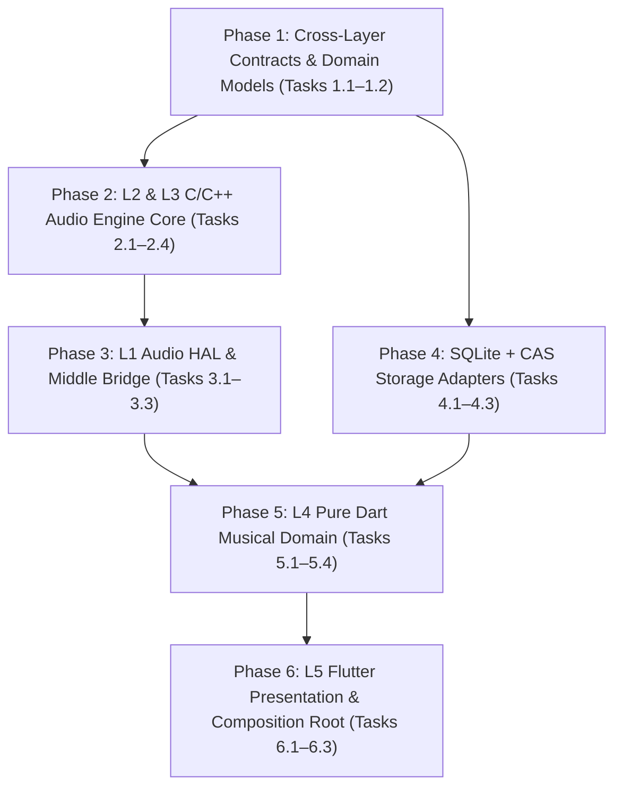

# MuseGrid Phase-by-Phase Implementation Plan

## Goal Description

Decompose the MuseGrid 5-Layer + Middle Bridge architecture ([ARCHITECTURE.md](file:///Users/goldenfung/Documents/muse_grid/ARCHITECTURE.md), [database.md](file:///Users/goldenfung/Documents/muse_grid/database.md), [interfaces_classes.md](file:///Users/goldenfung/Documents/muse_grid/interfaces_classes.md), [requirements.md](file:///Users/goldenfung/Documents/muse_grid/requirements.md), and [toolchain_and_dependencies.md](file:///Users/goldenfung/Documents/muse_grid/toolchain_and_dependencies.md)) into 6 strictly ordered bottom-up phases and **19 verifiable tasks** (1–5 files per task).

Every phase builds exclusively on layers below it, enforces zero upward imports (`.agents/rules/architecture-layering.md`), real-time audio callback safety (`.agents/rules/audio-engine-rt-safety.md`), centralized constants and fail-closed error handling (`.agents/rules/coding-style.md`), and ends with an automated verification checkpoint before the next phase begins.



---

## User Review Required

> [!IMPORTANT]
> **1. Native C/C++ Build Integration Strategy (Phase 3 — Task 3.1):**
> `sqlite3` `3.9.1` and `ffigen` `23.0.0` in [pubspec.lock](file:///Users/goldenfung/Documents/muse_grid/pubspec.lock) already pull `hooks` `2.2.0`, `code_assets` `2.2.0`, and `native_toolchain_c` `0.19.6`. In Task 3.1, we plan to use a root Dart Build Hook (`hook/build.dart`) that compiles `packages/muse_audio_engine/` sources and links the CMake-built static `libfluidsynth.a` (`packages/muse_audio_engine/.build/_deps/fluidsynth-build/src/libfluidsynth.a`) into a dynamic code asset for `dart:ffi`, alongside `tool/ffigen.dart` (`FfiGenerator`).

> [!IMPORTANT]
> **2. `crisp_notation_core` `0.14.0` Dual-Model Mapping Rules (Phase 5 — Task 5.2):**
> Based on inspecting [element.dart](file:///Users/goldenfung/.pub-cache/hosted/pub.dev/crisp_notation_core-0.14.0/lib/src/model/element.dart#L159-L355) and [measure.dart](file:///Users/goldenfung/.pub-cache/hosted/pub.dev/crisp_notation_core-0.14.0/lib/src/model/measure.dart#L210-L233):
> - **Chords:** Simultaneous `TimelineNote` rows sharing `(partId, staffNumber, voiceNumber, quantizedStartTick, quantizedDurationTicks)` are grouped into one `NoteElement(pitches: [...], id: lowestPitchNote.noteId.value)`. Spanners (`tie`, `slur`, `beam`) referencing any note in that chord map deterministically to the chord's primary `NoteElement.id`.
> - **Rests & Cross-Barline Notes:** Because SQLite `timeline_notes` stores only notes, `DualModelScoreService` synthesizes `RestElement`s for silent gaps per voice (`1..4`) and splits quantized notes crossing barlines into tied `NoteElement`s (`tieToNext: true`).
> - **Grand Staves:** A `ProjectPartEntity` with `stavesCount == 2` maps to two adjacent `Score` entries in `StaffSystem.staves` joined by `StaffBracket(idx, idx + 1, kind: StaffBracketKind.brace)` and `BarlineGroup(idx, idx + 1)`.

> [!WARNING]
> **3. macOS Sandboxed Microphone Entitlements (Phase 3 — Task 3.1):**
> In addition to [ios/Runner/Info.plist](file:///Users/goldenfung/Documents/muse_grid/ios/Runner/Info.plist) and [android/app/src/main/AndroidManifest.xml](file:///Users/goldenfung/Documents/muse_grid/android/app/src/main/AndroidManifest.xml), [macos/Runner/DebugProfile.entitlements](file:///Users/goldenfung/Documents/muse_grid/macos/Runner/DebugProfile.entitlements) and [macos/Runner/Release.entitlements](file:///Users/goldenfung/Documents/muse_grid/macos/Runner/Release.entitlements) have `com.apple.security.app-sandbox = true` without `com.apple.security.device.audio-input`. Task 3.1 adds `NSMicrophoneUsageDescription` to [macos/Runner/Info.plist](file:///Users/goldenfung/Documents/muse_grid/macos/Runner/Info.plist) and `com.apple.security.device.audio-input` to both macOS entitlement files so `miniaudio` duplex capture does not fail on macOS desktop builds.

---

## Open Questions & Confirmed Decisions

> [!NOTE]
> Please confirm if you want any adjustments to these two execution preferences before we start Phase 1:
> 1. **Execution Cadence (Confirmed):** We will pause for your review at the end of **each Phase Checkpoint** before proceeding to the next phase.
> 2. **Default SoundFont Bundling (Confirmed):** Bundled default GM SoundFont at [assets/sf2/GeneralUser_GS_MuseScore_v1.442.sf2](file:///Users/goldenfung/Documents/muse_grid/assets/sf2/GeneralUser_GS_MuseScore_v1.442.sf2) (`31,277,462` bytes / `29.83 MiB`, within `kMaxWebSoundFontBytes = 64 MiB`; SHA-256 `d910e139f619048b331d72d2e0867f1729f9725e2a97a6be32b09b8b5b5c4b12`). Registered in [pubspec.yaml](file:///Users/goldenfung/Documents/muse_grid/pubspec.yaml) and seeded into `cas/d9/d910e139...sf2` + SQLite (`soundfonts`, `soundfont_presets`) on first startup so new/imported parts have a valid default `sfId`.
> 3. **Native Build Hook & macOS Sandbox Entitlements (Confirmed):** Root `hook/build.dart` (`native_toolchain_c` + `code_assets`) and `com.apple.security.device.audio-input` in [DebugProfile.entitlements](file:///Users/goldenfung/Documents/muse_grid/macos/Runner/DebugProfile.entitlements) / [Release.entitlements](file:///Users/goldenfung/Documents/muse_grid/macos/Runner/Release.entitlements) are approved for Phase 3 (Task 3.1).

---

## Proposed Changes

### Phase 1: Cross-Layer Contracts, Branded Types, Domain Models & Repository Interfaces

Establishes the Pure Dart (`WasmGC`-compatible) foundation shared by Bridge, Storage, L4, and L5, registers the bundled default `.sf2` asset in [pubspec.yaml](file:///Users/goldenfung/Documents/muse_grid/pubspec.yaml), and fixes the unfiltered `ctest` issue in `packages/muse_audio_engine/CMakeLists.txt`.

---

#### Task 1.1: Error Union, Branded IDs/Units, Centralized Constants & Segregated Audio Bridge Contracts
* **Scope:** Medium (4 files) | **Dependencies:** None
* **Files:**
  * #### [NEW] `lib/bridge/contracts/result.dart`
  * #### [NEW] `lib/bridge/contracts/ids_and_units.dart`
  * #### [NEW] `lib/bridge/contracts/engine_constants.dart`
  * #### [NEW] `lib/bridge/contracts/audio_bridge_contracts.dart`
* **Implementation Details:**
  * Implement `MuseErrorCode` (24 error codes), `MuseError`, and `sealed class Result<T>` (`Ok<T>`, `Err<T>`) per [interfaces_classes.md](file:///Users/goldenfung/Documents/muse_grid/interfaces_classes.md#L28-L83).
  * Implement Dart 3 `extension type const` wrappers (`ProjectId`, `PartId`, `NoteId`, `SpannerId`, `TempoEventId`, `TimeSigEventId`, `KeySigEventId`, `ClefEventId`, `TakeId`, `SoundFontId`, `CalibrationProfileId`, `Sha256Digest`, `Tick`, `SampleFrame`, `EpochId`, `SoundFontHandle`) per [interfaces_classes.md](file:///Users/goldenfung/Documents/muse_grid/interfaces_classes.md#L86-L105).
  * Implement `MuseConstants` in `lib/bridge/contracts/engine_constants.dart` including engine timing/buffer constants (`ppqn = 960`, `wholeNoteTicks = 3840`, `lookaheadWindowMs = 200`, `lookaheadRefillIntervalMs = 25`, `maxWebSoundFontBytes = 67108864`, etc.), bundled default SoundFont metadata (`defaultSoundFontAssetPath = 'assets/sf2/GeneralUser_GS_MuseScore_v1.442.sf2'`, `defaultSoundFontDisplayName = 'GeneralUser GS MuseScore v1.442'`, `defaultSoundFontSha256 = 'd910e139f619048b331d72d2e0867f1729f9725e2a97a6be32b09b8b5b5c4b12'`, `defaultSoundFontByteSize = 31277462`), and the canonical rhythmic subdivision constants (`straight`, `dotted`, `triplet` tick counts from [ARCHITECTURE.md](file:///Users/goldenfung/Documents/muse_grid/ARCHITECTURE.md#L165-L167)).
  * Implement `IInternalStorageLocator`, `IAudioLifecycleBridge`, `ITransportBridge`, `ISynthEventBridge`, `IRecordingBridge`, `ITelemetryBridge`, and their transfer classes (`AudioHardwareInfo`, `SoundFontPresetInfo`, `LoadedSoundFontDescriptor`, `ActiveTakePlaybackRegion`, `ScheduledMidiEvent`, `RecordingCaptureReceipt`, `TelemetrySnapshot`) per [interfaces_classes.md](file:///Users/goldenfung/Documents/muse_grid/interfaces_classes.md#L484-L690).
* **Acceptance Criteria:**
  * Zero imports of `dart:ffi`, `dart:io`, `package:web`, or `package:flutter`.
  * All constants and error codes match [interfaces_classes.md](file:///Users/goldenfung/Documents/muse_grid/interfaces_classes.md) with zero magic numbers.

---

#### Task 1.2: Pure Dart Domain Entities, Storage Repository Contracts, Default `.sf2` Asset Registration & CTest Fix
* **Scope:** Medium (5 files) | **Dependencies:** Task 1.1
* **Files:**
  * #### [NEW] `lib/domain/models/score_models.dart`
  * #### [NEW] `lib/domain/repositories/storage_contracts.dart`
  * #### [MODIFY] [pubspec.yaml](file:///Users/goldenfung/Documents/muse_grid/pubspec.yaml)
  * #### [MODIFY] [CMakeLists.txt](file:///Users/goldenfung/Documents/muse_grid/packages/muse_audio_engine/CMakeLists.txt)
  * #### [NEW] `test/contracts/contracts_and_models_test.dart`
* **Implementation Details:**
  * Implement all immutable domain entities and inputs in `lib/domain/models/score_models.dart` (`ProjectSummary`, `CreateProjectInput`, `UpdateProjectMetadataInput`, `ProjectPartEntity`, `TempoEventEntity`, `TimeSignatureEventEntity`, `KeySignatureEventEntity`, `ClefEventEntity`, `TimelineNote`, `NoteSpannerEntity`, `AudioTakeEntity`, `SoundFontCatalogEntry`, `LatencyCalibrationProfile`, `UpsertCalibrationProfileInput`, `PickedExternalFile`, `AudioTakeRealignmentUpdate`, `ProjectWorkspaceAggregate`, `ScoreMutationBatch`) per [interfaces_classes.md](file:///Users/goldenfung/Documents/muse_grid/interfaces_classes.md#L700-L1116).
  * Implement `IStorageMaintenanceRepository`, `IProjectRepository`, `IAssetLibraryRepository`, and `IExternalFileExchange` in `lib/domain/repositories/storage_contracts.dart` per [interfaces_classes.md](file:///Users/goldenfung/Documents/muse_grid/interfaces_classes.md#L1120-L1215).
  * Register [assets/sf2/GeneralUser_GS_MuseScore_v1.442.sf2](file:///Users/goldenfung/Documents/muse_grid/assets/sf2/GeneralUser_GS_MuseScore_v1.442.sf2) under `flutter: assets:` in [pubspec.yaml](file:///Users/goldenfung/Documents/muse_grid/pubspec.yaml#L73-L78).
  * In [packages/muse_audio_engine/CMakeLists.txt](file:///Users/goldenfung/Documents/muse_grid/packages/muse_audio_engine/CMakeLists.txt#L62), clear `${fluidsynth_BINARY_DIR}/test/CTestTestfile.cmake` after `FetchContent_MakeAvailable(fluidsynth)` so plain `ctest` does not attempt to run FluidSynth's 45 unbuilt upstream test targets:
    ```cmake
    FetchContent_MakeAvailable(fluidsynth)
    if(EXISTS "${fluidsynth_BINARY_DIR}/test/CTestTestfile.cmake")
      file(WRITE "${fluidsynth_BINARY_DIR}/test/CTestTestfile.cmake"
        "# Upstream FluidSynth unit tests disabled in MuseGrid superbuild\n")
    endif()
    ```
* **Checkpoint — Phase 1 Verification (Pause for User Review):**
  * `flutter analyze`
  * `flutter test test/contracts/contracts_and_models_test.dart`
  * `ctest --test-dir packages/muse_audio_engine/.build --build-config Release --output-on-failure` (passes 3/3 without requiring `-R`)

---

### Phase 2: Layer 2 & Layer 3 Audio Engine Core (`packages/muse_audio_engine/engine_core/`)

Implements the real-time safe C/C++ audio synthesis, SPSC lock-free ring buffers, 3-phase callback cycle, `FluidSynth` + `TakePlaybackRingBuffer` + soft limiter signal graph, Native Butler worker (`ma_encoder` WAV + `PicoSHA2`), and C ABI (`muse_engine_c_api.h`), verified via offline `Catch2` tests and Emscripten Wasm compilation.

---

#### Task 2.1: L2 Constants, HAL Contract, POD Structs (`rt_pods.h`) & Lock-Free `SpscRingBuffer`
* **Scope:** Medium (4 files) | **Dependencies:** Phase 1
* **Files:**
  * #### [NEW] `packages/muse_audio_engine/engine_core/engine_constants.h`
  * #### [NEW] `packages/muse_audio_engine/engine_core/hal_contract.h`
  * #### [NEW] `packages/muse_audio_engine/engine_core/infra/rt_pods.h`
  * #### [NEW] `packages/muse_audio_engine/engine_core/infra/spsc_queue.h`
  * #### [NEW] `packages/muse_audio_engine/tests/spsc_and_pods_test.cpp`
* **Implementation Details:**
  * Implement `engine_constants.h`, `hal_contract.h`, and `rt_pods.h` exactly matching the C11/C++17 ABI and `static_assert` size checks (`48`, `24`, `24`, `48`, `624` bytes) in [interfaces_classes.md](file:///Users/goldenfung/Documents/muse_grid/interfaces_classes.md#L127-L338).
  * Implement `SpscRingBuffer<T, Capacity>` in `infra/spsc_queue.h` using `std::atomic<size_t>` head/tail indices with `std::memory_order_acquire` / `std::memory_order_release`, cache-line alignment (`alignas(64)`), zero heap allocations, batch push/pop helpers, and zero-copy `peek()` / `consumeOne()`.
* **Acceptance Criteria:**
  * All `static_assert` size and `std::is_trivially_copyable_v` checks compile cleanly on both Native and Emscripten.
  * `spsc_and_pods_test.cpp` verifies single-item and batch push/pop, wrap-around across multiple full-capacity cycles, and full-queue rejection (`tryPush` returns `false` without overwriting).

---

#### Task 2.2: L3 Deterministic Signal Graph & 3-Phase Cycle (`startCycle`, `processAudio`, `endCycle`)
* **Scope:** Medium (3 files) | **Dependencies:** Task 2.1
* **Files:**
  * #### [NEW] `packages/muse_audio_engine/engine_core/audio_engine_core.h`
  * #### [NEW] `packages/muse_audio_engine/engine_core/audio_engine_core.cpp`
  * #### [NEW] `packages/muse_audio_engine/tests/engine_cycle_test.cpp`
* **Implementation Details:**
  * Pre-allocate `MutationQueue`, `EventQueue`, `CaptureRingBuffer`, `TakePlaybackRingBuffer`, `TelemetryQueue`, and stereo scratch buffers in `AudioEngineCore` initialization.
  * **`startCycle()`:** Enable hardware FTZ/DAZ on Native RT thread, consume `MutationQueue` commands (`MUT_SET_PLAYING`, `MUT_SEEK_SAMPLE`, `MUT_SET_LOOP_REGION`, `MUT_FLUSH_AND_ADVANCE_EPOCH`, `MUT_ASSIGN_CHANNEL_PATCH`, `MUT_SET_CHANNEL_MIX`, `MUT_ALL_NOTES_OFF_CHANNEL`, `MUT_SET_MONITOR_GAIN`, `MUT_SET_CAPTURE_STATE`), advance `active_epoch` and emit `fluid_synth_all_notes_off` on epoch advance or seek.
  * **`processAudio()`:**
    1. Drain `EventQueue` events: if `event.epoch < active_epoch`, discard; if `target_sample_frame == 0` (live audition) or (`is_playing` and `target_sample_frame < sample_clock + frame_count`), dispatch to `FluidSynth` (`fluid_synth_noteon`, `fluid_synth_noteoff`, `fluid_synth_cc`, `fluid_synth_pitch_bend`).
    2. Render `FluidSynth` into pre-allocated stereo float buffers via `fluid_synth_write_float()`.
    3. When `is_playing`, drain matching frames from `TakePlaybackRingBuffer` (setting `take_playback_underrun = 1` if active takes are registered for the current frame window but the ring buffer is starved) and mix into the stereo bus.
    4. Mix `input_interleaved * monitor_gain` (when `monitor_gain > 0.0f`).
    5. Apply master soft limiter ($\tanh$-approximated or cubic soft-knee brickwall ceiling at $\pm 1.0$) to `output_interleaved`.
    6. When `is_capturing && !is_capture_paused`, push `input_interleaved` into `CaptureRingBuffer` (latching `captured_sample_clock` on the first frame; setting `capture_buffer_overflow = 1` and aborting capture fail-closed on full buffer).
    7. Compute block peak/RMS for output L/R and mic input, and push `TelemetryFrame` to `TelemetryQueue`.
  * **`endCycle()`:** Advance `sample_clock` (and `playhead_sample_frame` when `is_playing`, wrapping at `loop_end_frame` if loop is enabled and advancing epoch on loop wrap) and notify Butler condition variable (when capture frames exceed watermark on Native).

---

#### Task 2.3: L3 Native Butler Worker (WAV Capture Encoding, Finalize-Then-Hash & Active Take Resampling)
* **Scope:** Medium (3 files) | **Dependencies:** Task 2.2
* **Files:**
  * #### [NEW] `packages/muse_audio_engine/engine_core/butler_worker.h`
  * #### [NEW] `packages/muse_audio_engine/engine_core/butler_worker.cpp`
  * #### [NEW] `packages/muse_audio_engine/tests/butler_worker_test.cpp`
* **Implementation Details:**
  * Guarded by `#if !defined(__EMSCRIPTEN__)` for Native builds:
    * **Recording Pipeline:** `prepareCapture(staging_wav_path)` initializes `ma_encoder` (`ma_encoding_format_wav`, `ma_format_f32`, device channels & sample rate) on the Butler thread before capture starts. While capturing, the Butler thread drains `CaptureRingBuffer` and calls `ma_encoder_write_pcm_frames`. On `stopAndFinalizeCapture()`, it drains remaining frames, calls `ma_encoder_uninit()` to patch the RIFF/`data` header sizes, streams the finalized file through `picosha2::hash256`, and populates `FinalizedCaptureReceipt` (including latched `output_buffer_frames` and `input_buffer_frames`).
    * **Active Take Streaming:** `registerActiveTake(...)` opens `cas/<aa>/<sha256>.wav` via `ma_decoder`, configures `ma_data_converter` when the take's sample rate or channel count differs from `MuseHardwareConfig`, applies `gain_db` ($10^{\text{dB}/20}$) and constant-power stereo `pan`, sums overlapping active takes relative to the timeline playhead, and feeds `TakePlaybackRingBuffer`.

---

#### Task 2.4: C11/C++17 Public API (`muse_engine_c_api.h` / `.cpp`) & CMake Target Wiring
* **Scope:** Medium (4 files) | **Dependencies:** Tasks 2.2, 2.3
* **Files:**
  * #### [NEW] `packages/muse_audio_engine/engine_core/muse_engine_c_api.h`
  * #### [NEW] `packages/muse_audio_engine/engine_core/muse_engine_c_api.cpp`
  * #### [MODIFY] [CMakeLists.txt](file:///Users/goldenfung/Documents/muse_grid/packages/muse_audio_engine/CMakeLists.txt)
  * #### [NEW] `packages/muse_audio_engine/tests/c_api_integration_test.cpp`
* **Implementation Details:**
  * Implement all 16 functions in `muse_engine_c_api.h` ([interfaces_classes.md](file:///Users/goldenfung/Documents/muse_grid/interfaces_classes.md#L375-L476)), including `muse_engine_load_sf2_file`, `muse_engine_load_sf2_bytes` (enforcing `byte_length <= kMaxWebSoundFontBytes` and stopped transport on Web, and iterating FluidSynth presets via `fluid_sfont_iteration_start` / `fluid_sfont_iteration_next` with fail-closed `MUSE_ERR_BUFFER_TOO_SMALL`), `muse_engine_process_block`, and `muse_engine_drain_capture_frames`.
  * Register static library target `muse_audio_engine_core` in [packages/muse_audio_engine/CMakeLists.txt](file:///Users/goldenfung/Documents/muse_grid/packages/muse_audio_engine/CMakeLists.txt) and link it into the `Catch2` test suite and Emscripten build.
* **Checkpoint — Phase 2 Verification:**
  * `cmake --build packages/muse_audio_engine/.build --config Release --parallel`
  * `ctest --test-dir packages/muse_audio_engine/.build --build-config Release --output-on-failure`
  * `dart run tool/setup_audio_engine.dart` (verifies both Native CTest suite and Emscripten Wasm compilation)

---

### Phase 3: Layer 1 Platform Audio HAL & Middle Bridge (`packages/muse_audio_engine/{native,web}/` & `lib/bridge/{native,web}/`)

Connects `engine_core` to hardware duplex audio (`miniaudio` on Native, `AudioWorklet` on Web) and exposes the 5 Middle Bridge interfaces to Dart.

---

#### Task 3.1: Native `miniaudio` Duplex HAL, Dart Build Hook (`hook/build.dart`) & Platform Manifests
* **Scope:** Medium (5 files) | **Dependencies:** Phase 2
* **Files:**
  * #### [NEW] `packages/muse_audio_engine/native/miniaudio_duplex_hal.cpp`
  * #### [NEW] `hook/build.dart`
  * #### [MODIFY] [Info.plist](file:///Users/goldenfung/Documents/muse_grid/ios/Runner/Info.plist)
  * #### [MODIFY] [AndroidManifest.xml](file:///Users/goldenfung/Documents/muse_grid/android/app/src/main/AndroidManifest.xml)
  * #### [MODIFY] [Info.plist](file:///Users/goldenfung/Documents/muse_grid/macos/Runner/Info.plist), [DebugProfile.entitlements](file:///Users/goldenfung/Documents/muse_grid/macos/Runner/DebugProfile.entitlements), [Release.entitlements](file:///Users/goldenfung/Documents/muse_grid/macos/Runner/Release.entitlements)
* **Implementation Details:**
  * Implement `IPlatformAudioHal` in `miniaudio_duplex_hal.cpp` using `#define MINIAUDIO_IMPLEMENTATION` and `ma_device_type_duplex` (`ma_format_f32`), configuring `ma_ios_session_category_play_and_record` on iOS and AAudio low-latency mode with explicit logged fallback to shared mode on Android (`.agents/rules/audio-engine-rt-safety.md` Rules 15–17). Also support an offline/headless loopback fallback mode when `MUSE_HEADLESS_AUDIO=1` is set in CI test environments without physical audio devices.
  * Create `hook/build.dart` using `package:hooks`, `package:code_assets`, and `package:native_toolchain_c` so `flutter test` and `flutter build` automatically compile/link `muse_audio_engine` and `libfluidsynth.a`.
  * Add `NSMicrophoneUsageDescription` to iOS/macOS `Info.plist`, `com.apple.security.device.audio-input` to macOS entitlements, and `android.permission.RECORD_AUDIO` to `AndroidManifest.xml`.

---

#### Task 3.2: `ffigen` Generator (`tool/ffigen.dart`) & `NativeAudioBridge` (`lib/bridge/native/`)
* **Scope:** Small (3 files) | **Dependencies:** Task 3.1
* **Files:**
  * #### [NEW] `tool/ffigen.dart`
  * #### [NEW] `lib/bridge/native/muse_engine_bindings.g.dart`
  * #### [NEW] `lib/bridge/native/native_audio_bridge.dart`
  * #### [NEW] `test/bridge/native_audio_bridge_test.dart`
* **Implementation Details:**
  * Create `tool/ffigen.dart` using `ffigen` `23.0.0`'s `FfiGenerator` API pointing at `packages/muse_audio_engine/engine_core/muse_engine_c_api.h` to generate `lib/bridge/native/muse_engine_bindings.g.dart`.
  * Implement `NativeAudioBridge` implementing `IAudioLifecycleBridge`, `ITransportBridge`, `ISynthEventBridge`, `IRecordingBridge`, and `ITelemetryBridge` using `dart:ffi` + `package:ffi`, sharing a single monotonic `_currentEpoch` between `seekToSample()` and `flushAndAdvanceEpoch()`, and resolving CAS/staging paths via injected `IInternalStorageLocator`.

---

#### Task 3.3: Emscripten Wasm `AudioWorklet` Target & `WebAudioWorkletBridge` (`lib/bridge/web/`)
* **Scope:** Medium (4 files) | **Dependencies:** Task 2.4
* **Files:**
  * #### [NEW] `packages/muse_audio_engine/web/wasm_worklet_bindings.cpp`
  * #### [NEW] `web/muse_audio_worklet_processor.js`
  * #### [MODIFY] [CMakeLists.txt](file:///Users/goldenfung/Documents/muse_grid/packages/muse_audio_engine/CMakeLists.txt)
  * #### [NEW] `lib/bridge/web/web_audio_worklet_bridge.dart`
* **Implementation Details:**
  * Export the `muse_engine_*` C ABI functions in Emscripten (`-sEXPORTED_FUNCTIONS=...`, `-sALLOW_MEMORY_GROWTH=1`, `-sMAXIMUM_MEMORY=268435456`, `-sENVIRONMENT=worker,shell`) producing `web/muse_audio_engine.js` and `web/muse_audio_engine.wasm`.
  * Implement `web/muse_audio_worklet_processor.js` (`AudioWorkletProcessor`) invoking `muse_engine_process_block` per 128-frame quantum and batch-transferring captured PCM every `kWebCaptureBatchQuanta = 32` blocks over `MessagePort` when `SharedArrayBuffer` is unavailable.
  * Implement `WebAudioWorkletBridge` in `lib/bridge/web/web_audio_worklet_bridge.dart` using `package:web` and `dart:js_interop` (enforcing user-gesture `AudioContext.resume()`, `kMaxWebSoundFontBytes`, and stopped-transport SF2 load policy).
* **Checkpoint — Phase 3 Verification:**
  * `dart run tool/ffigen.dart`
  * `dart run tool/setup_audio_engine.dart`
  * `flutter analyze`
  * `flutter test test/bridge/native_audio_bridge_test.dart`
  * `flutter build web --wasm`

---

### Phase 4: SQLite + Content-Addressed Storage Adapters (`lib/storage/{native,web}/`)

Implements the 13-table `STRICT` SQLite schema ([database.md](file:///Users/goldenfung/Documents/muse_grid/database.md#L92-L335)), journal-mode verification, atomic CAS promotion, Mark-and-Sweep GC, and platform file exchange.

---

#### Task 4.1: Shared SQLite Schema DDL, Migration Runner & SQL Query Executor
* **Scope:** Medium (4 files) | **Dependencies:** Phase 1
* **Files:**
  * #### [NEW] `lib/storage/common/sqlite_schema_ddl.dart`
  * #### [NEW] `lib/storage/common/sql_project_repository.dart`
  * #### [NEW] `lib/storage/common/sql_asset_library_repository.dart`
  * #### [NEW] `test/storage/sqlite_repositories_test.dart`
* **Implementation Details:**
  * Define the exact 13 `STRICT` tables and indexes from [database.md](file:///Users/goldenfung/Documents/muse_grid/database.md#L96-L335) in `sqlite_schema_ddl.dart` (`schema_migrations`, `content_blobs`, `projects`, `project_parts`, `tempo_events`, `time_signature_events`, `key_signature_events`, `clef_events`, `timeline_notes`, `note_spanners`, `audio_takes`, `soundfonts`, `soundfont_presets`, `latency_calibration_profiles`).
  * Implement `SqlProjectRepository` (`IProjectRepository`) and `SqlAssetLibraryRepository` (`IAssetLibraryRepository`) against `package:sqlite3/common.dart`'s `CommonDatabase` so the exact same prepared statements and `BEGIN IMMEDIATE ... COMMIT` transactions run on both Native (`sqlite3` FFI) and Web (`sqlite3.wasm`).
  * Enforce optimistic concurrency (`WHERE project_id = ? AND revision = ?`, returning `MuseErrorCode.revisionConflict` when `updatedRows == 0`), protected initial map events (`tick == 0` check), and Mark-and-Sweep GC (`DELETE FROM content_blobs WHERE NOT EXISTS ... RETURNING sha256, ext`).

---

#### Task 4.2: Native Storage Adapter (`lib/storage/native/`)
* **Scope:** Small (3 files) | **Dependencies:** Task 4.1
* **Files:**
  * #### [NEW] `lib/storage/native/native_storage_adapter.dart`
  * #### [NEW] `lib/storage/native/native_external_file_exchange.dart`
  * #### [NEW] `test/storage/native_storage_adapter_test.dart`
* **Implementation Details:**
  * Implement `IStorageMaintenanceRepository` and `IInternalStorageLocator` in `NativeStorageAdapter`:
    * Uses `getApplicationSupportDirectory()` for `db/musegrid.db`, `cas/<aa>/<sha256>.<ext>`, and `staging/rec_<take_id>.wav.part`.
    * Sets `PRAGMA foreign_keys = ON;`, `PRAGMA busy_timeout = 5000;`, `PRAGMA journal_mode = WAL;`, `PRAGMA synchronous = NORMAL;`, and verifies `PRAGMA journal_mode` returns `'wal'` (failing closed with `sqliteJournalModeMismatch` otherwise).
    * Sweeps orphaned `staging/*.part` files on startup and promotes finalized staging files via atomic `File.rename()`.
  * Implement `NativeExternalFileExchange` (`IExternalFileExchange`) using `file_picker` (Copy-on-Import) and `share_plus` + `getTemporaryDirectory()` (Stage-on-Export).

---

#### Task 4.3: Web OPFS Storage Adapter (`lib/storage/web/`)
* **Scope:** Small (2 files) | **Dependencies:** Task 4.1
* **Files:**
  * #### [NEW] `lib/storage/web/web_opfs_storage_adapter.dart`
  * #### [NEW] `lib/storage/web/web_external_file_exchange.dart`
* **Implementation Details:**
  * Implement `WebOpfsStorageAdapter` using `package:sqlite3/wasm.dart` (`WasmSqlite3.loadFromUrl(Uri.parse('sqlite3.wasm'))` + `SimpleOpfsFileSystem` with logged `IndexedDbFileSystem` degraded fallback) and `package:web` OPFS directory handles for `/cas` and `/staging`.
  * Verify `PRAGMA journal_mode` is `delete` or `truncate` (never issuing `WAL` on Web OPFS).
  * Request `navigator.storage.persist()` on initialization and check `navigator.storage.estimate()` (`quota - usage >= requiredBytes`) in `verifyAvailableQuotaBytes()`, failing closed with `insufficientStorageQuota`.
* **Checkpoint — Phase 4 Verification:**
  * `flutter analyze`
  * `flutter test test/storage/`
  * `flutter build web --wasm`

---

### Phase 5: Layer 4 Pure Dart Musical & Notation Domain (`lib/domain/`)

Implements the 6 Pure Dart domain services/coordinators in `lib/domain/` with zero Flutter, FFI, IO, or Web imports.

---

#### Task 5.1: `TempoTimelineCalculator` & `SoundFontPresetParser`
* **Scope:** Medium (4 files) | **Dependencies:** Phase 1
* **Files:**
  * #### [NEW] `lib/domain/timeline/tempo_timeline_calculator.dart`
  * #### [NEW] `lib/domain/assets/soundfont_preset_parser.dart`
  * #### [NEW] `test/domain/tempo_timeline_calculator_test.dart`
  * #### [NEW] `test/domain/soundfont_preset_parser_test.dart`
* **Implementation Details:**
  * **`TempoTimelineCalculator` (`ITempoTimelineCalculator`):**
    * Implement exact segment-wise integer `tickToSampleFrame` and `sampleFrameToTick` using `BigInt` intermediate products (`(tick - segStartTick) * usPerQuarter * sampleRate ~/ (960 * 1000000)`) per [database.md](file:///Users/goldenfung/Documents/muse_grid/database.md#L88).
    * Implement `quantizeTick`, `computeLatencyCompensatedStartTick` (`max(0, capturedSampleClock - (outputBufferFrames + inputBufferFrames + calibrationOffsetFrames))` → tick), and `queryVisibleGridLines` (handling `pickupTicks > 0` as Measure `0` and generating measure/beat/subdivision lines across time-signature changes).
  * **`SoundFontPresetParser` (`ISoundFontPresetParser`):**
    * Parse SF2 `RIFF` (`sfbk`) → `LIST` (`pdta`) → `phdr` subchunk (38-byte records: 20-byte ASCII `achPresetName`, `uint16 wPreset`, `uint16 wBank`, excluding the terminal `EOP` record) from a `Stream<List<int>>`, failing closed with `MuseErrorCode.invalidSoundFontFormat` on malformed headers or non-SF2 files.

---

#### Task 5.2: `DualModelScoreService` (`960 PPQN` ↔ `crisp_notation_core` `0.14.0` & MusicXML)
* **Scope:** Medium (3 files) | **Dependencies:** Task 5.1
* **Files:**
  * #### [NEW] `lib/domain/notation/dual_model_score_service.dart`
  * #### [NEW] `lib/domain/notation/crisp_score_mapper.dart`
  * #### [NEW] `test/domain/dual_model_score_service_test.dart`
* **Implementation Details:**
  * Implement `IDualModelScoreService` per [interfaces_classes.md](file:///Users/goldenfung/Documents/muse_grid/interfaces_classes.md#L1279-L1328):
    * **`buildWorkspaceState` & `applyMutationToDualModel`:**
      * Maintain an in-memory sorted spatial index of `TimelineNote`s per `PartId` for $O(\log N + K)$ `queryNotesInViewport`.
      * Map each `ProjectPartEntity` (`stavesCount == 1` or `2`) to `Score` staves inside `StaffSystem` (adding `StaffBracketKind.brace` and `BarlineGroup` for 2-staff parts).
      * Group simultaneous `TimelineNote`s sharing `(partId, staffNumber, voiceNumber, quantizedStartTick, quantizedDurationTicks)` into a single `NoteElement` with `id = lowestPitchNote.noteId.value`, synthesize `RestElement`s for silent gaps per voice (`elements`, `voice2`, `voice3`, `voice4`), split cross-barline notes with `tieToNext: true`, and translate `NoteSpannerEntity` rows into `tieToNext`, `Score.slurs`, `Score.beamSpans`, and `Score.crossMeasureBeams`.
    * **`importFromMusicXmlBytes` & `exportToMusicXmlBytes`:**
      * Use `crisp_notation_core`'s `extractMxlMusicXml` / `packMxl` (for `.mxl`) and `multiPartScoreFromMusicXml` / `multiPartToMusicXml`, remapping `crisp_notation_core`'s sequential `e0, e1, ...` element IDs to fresh `Uuid().v7()` `NoteId`s on import.

---

#### Task 5.3: `ScoreEditingCommandBus` (Reversible Command Stack & Fail-Closed Validation)
* **Scope:** Small (2 files) | **Dependencies:** Task 5.2
* **Files:**
  * #### [NEW] `lib/domain/commands/score_editing_command_bus.dart`
  * #### [NEW] `test/domain/score_editing_command_bus_test.dart`
* **Implementation Details:**
  * Implement all 16 `ScoreCommand` subclasses and `IScoreEditingCommandBus` per [interfaces_classes.md](file:///Users/goldenfung/Documents/muse_grid/interfaces_classes.md#L1335-L1430).
  * Validate commands fail-closed before persistence:
    * Reject `DeleteTempoEventCommand` and `DeleteTimeSignatureCommand` targeting `tick == 0` with `MuseErrorCode.protectedInitialMapEvent`.
    * Reject out-of-range MIDI channels (`0..15`), pitches (`0..127`), or velocities (`1..127`) with `MuseErrorCode.invalidMidiChannelOrPitch`.
  * Compute both forward and inverse `ScoreMutationBatch` objects for each command, commit via `IProjectRepository.commitScoreMutationBatch()`, update `IDualModelScoreService.applyMutationToDualModel()`, emit on `stateStream`, and invoke `ILookaheadPlaybackCoordinator.notifyScoreMutatedInRange()` when an edit touches musical timing or mixer state.

---

#### Task 5.4: `LookaheadPlaybackCoordinator` & `RecordingSessionCoordinator`
* **Scope:** Medium (4 files) | **Dependencies:** Tasks 5.1–5.3
* **Files:**
  * #### [NEW] `lib/domain/playback/lookahead_playback_coordinator.dart`
  * #### [NEW] `lib/domain/recording/recording_session_coordinator.dart`
  * #### [NEW] `test/domain/lookahead_playback_coordinator_test.dart`
  * #### [NEW] `test/domain/recording_session_coordinator_test.dart`
* **Implementation Details:**
  * **`LookaheadPlaybackCoordinator` (`ILookaheadPlaybackCoordinator`):**
    * In `attachProject()`, verify every non-muted part containing `TimelineNote`s has a non-null `sfId` (or fail closed with `missingSoundFontForPart`), load SoundFonts via `IAudioLifecycleBridge.loadSoundFontFromCas()`, assign channel patches/mixes via `ISynthEventBridge`, and sync active audio takes via `ITransportBridge.syncActiveTakeRegions()`.
    * Run a periodic 25 ms timer (`MuseConstants.lookaheadRefillIntervalMs`) while playing that reads `ITelemetryBridge` playhead, compiles audible notes falling within `[scheduledUpToSample, playheadSample + lookaheadWindowSamples)` (using `raw_*` or `quantized_*` ticks per `playbackTimingMode`), and schedules `ScheduledMidiEvent`s tagged with `currentEpoch`.
    * On `seekToTick()` or `notifyScoreMutatedInRange()` intersecting the lookahead horizon, flush and advance the epoch and refill the window immediately.
  * **`RecordingSessionCoordinator` (`IRecordingSessionCoordinator`):**
    * Run `verifyAvailableQuotaBytes(requiredBytes: MuseConstants.minRecordingFreeQuotaBytes)` before recording, schedule optional count-in clicks, start capture via `IRecordingBridge.prepareAndStartCapture(takeId)`, compute `alignedStartTick` on stop using `ITempoTimelineCalculator.computeLatencyCompensatedStartTick` and `IAssetLibraryRepository.getCalibrationProfile()`, and commit via `IProjectRepository.promoteAndCommitRecordedTake()`.
* **Checkpoint — Phase 5 Verification:**
  * `flutter analyze`
  * `flutter test test/domain/`

---

### Phase 6: Layer 5 Flutter Presentation & Composition Root (`lib/presentation/` & `lib/app/`)

Implements the 5 UI controllers, interactive 5-line staff view (`crisp_notation`), custom viewport-culled Piano Roll Dynamic Grid, transport/telemetry meters, and platform-conditional dependency injection in `lib/app/`.

---

#### Task 6.1: L5 Controllers (`ProjectCatalogController`, `WorkspaceShellController`, `TransportAndTelemetryController`)
* **Scope:** Medium (4 files) | **Dependencies:** Phase 5
* **Files:**
  * #### [NEW] `lib/presentation/controllers/project_catalog_controller.dart`
  * #### [NEW] `lib/presentation/controllers/workspace_shell_controller.dart`
  * #### [NEW] `lib/presentation/controllers/transport_and_telemetry_controller.dart`
  * #### [NEW] `test/presentation/controllers_test.dart`
* **Implementation Details:**
  * Implement `ProjectCatalogController` (`ChangeNotifier`) consuming `IProjectRepository`, `IAssetLibraryRepository`, `IExternalFileExchange`, `IDualModelScoreService`, `ISoundFontPresetParser`, and `ILookaheadPlaybackCoordinator` (handling project CRUD, `.musicxml`/`.mxl`/`.sf2`/`.wav` import/export, SoundFont deletion + `unloadUnusedSoundFont`, and latency calibration profile updates + `realignProjectTakesForCalibration`).
  * Implement `WorkspaceShellController` (`ChangeNotifier`) managing workspace attach/detach, Undo/Redo, project settings, and part mixer/patch commands.
  * Implement `TransportAndTelemetryController` polling `ITelemetryBridge.drainTelemetry()` at 60 Hz (`MuseConstants.telemetryPollHz`), updating `ValueNotifier<Tick> playheadTick`, peak/RMS meter state, live recording waveform peak/RMS ring, and surfacing fail-closed error banners on `hasCaptureBufferOverflow` / `hasEventQueueUnderrun` / `hasTakePlaybackUnderrun`.

---

#### Task 6.2: Staff Notation View (`crisp_notation`) & Custom Viewport-Culled Piano Roll Dynamic Grid
* **Scope:** Medium (5 files) | **Dependencies:** Task 6.1
* **Files:**
  * #### [NEW] `lib/presentation/notation/staff_notation_view_controller.dart`
  * #### [NEW] `lib/presentation/notation/staff_notation_panel.dart`
  * #### [NEW] `lib/presentation/piano_roll/piano_roll_viewport_controller.dart`
  * #### [NEW] `lib/presentation/piano_roll/piano_roll_grid_painter.dart`
  * #### [NEW] `lib/presentation/piano_roll/piano_roll_panel.dart`
* **Implementation Details:**
  * **`StaffNotationViewController` & `StaffNotationPanel`:**
    * Render `ScoreRenderSnapshot.crispScoreModel` via `crisp_notation`'s `StaffSystemView` (automatically setting `gridAlign: !hasMultiVoiceMeasures` per [staff_system_view.dart](file:///Users/goldenfung/.pub-cache/hosted/pub.dev/crisp_notation-0.14.0/lib/src/rendering/staff_system_view.dart#L33-L35)), highlighting active notes/selection and dispatching `ScoreCommand`s and live note auditions on tap/edit.
  * **`PianoRollViewportController`, `PianoRollGridPainter` & `PianoRollPanel`:**
    * Implement viewport-culled `CustomPainter` calling `IDualModelScoreService.queryNotesInViewport()` and `ITempoTimelineCalculator.queryVisibleGridLines()` with zoom-dependent subdivision LOD (`1/64`–`1/1`, dotted, triplets), velocity lane editing, snap-to-grid note creation/edge-resize, marquee box selection, pinch-to-zoom / wheel-zoom, and a separate `RepaintBoundary`-isolated playhead overlay painter listening only to `ValueListenable<Tick> playheadTick`.

---

#### Task 6.3: Workspace Shell UI, Composition Root (`lib/app/`) & Entrypoint (`lib/main.dart`)
* **Scope:** Medium (5 files) | **Dependencies:** Tasks 3.2, 3.3, 4.2, 4.3, 6.2
* **Files:**
  * #### [NEW] `lib/presentation/workspace/muse_grid_workspace_screen.dart`
  * #### [NEW] `lib/app/platform_wiring_stub.dart`
  * #### [NEW] `lib/app/platform_wiring_native.dart`
  * #### [NEW] `lib/app/platform_wiring_web.dart`
  * #### [NEW] `lib/app/muse_grid_app_bootstrap.dart`
  * #### [MODIFY] [main.dart](file:///Users/goldenfung/Documents/muse_grid/lib/main.dart)
  * #### [MODIFY] [widget_test.dart](file:///Users/goldenfung/Documents/muse_grid/test/widget_test.dart)
* **Implementation Details:**
  * Use conditional imports in `lib/app/muse_grid_app_bootstrap.dart`:
    ```dart
    import 'platform_wiring_stub.dart'
        if (dart.library.io) 'platform_wiring_native.dart'
        if (dart.library.js_interop) 'platform_wiring_web.dart';
    ```
  * Wire `NativeStorageAdapter` + `NativeAudioBridge` on Native and `WebOpfsStorageAdapter` + `WebAudioWorkletBridge` on Web, run `initializeAndVerifyStorage()` on startup, register `registerBundledFontLicenses()` from `crisp_notation`, and mount the split/tabbed Staff + Dynamic Grid Piano Roll + Transport/Recording workspace UI in `lib/main.dart`.
* **Checkpoint — Phase 6 & Full-System Verification:**
  * `flutter analyze`
  * `flutter test`
  * `flutter build web --wasm`

---

## Verification Plan

### Automated Tests
1. **C/C++ Audio Engine Offline Unit & Integration Tests (L2–L3):**
   ```sh
   cmake --build packages/muse_audio_engine/.build --config Release --parallel
   ctest --test-dir packages/muse_audio_engine/.build --build-config Release --output-on-failure
   ```
2. **Emscripten WebAssembly Engine Build Check (L1–L3 Web):**
   ```sh
   dart run tool/setup_audio_engine.dart
   ```
3. **Static Analysis, Layer Isolation & Dart/Flutter Test Suite (Bridge, Storage, L4, L5):**
   ```sh
   flutter analyze
   flutter test
   ```
4. **WebAssembly GC Full Application Build Gate:**
   ```sh
   flutter build web --wasm
   ```

### Manual Verification
1. **Project & MusicXML Flow:** Launch the app, create a new project or import a `.musicxml`/`.mxl` file, and verify simultaneous rendering in both the 5-line Staff view (`crisp_notation`) and the Dynamic Grid Piano Roll.
2. **Dual-Model Editing & Undo/Redo:** Add, drag, and resize notes in the Piano Roll under straight/dotted/triplet snap settings; verify the 5-line Staff updates in-place with preserved enharmonic spelling and Undo/Redo restores exact state.
3. **SoundFont Playback & Recording:** Import an `.sf2` SoundFont, verify preset extraction populates the part patch selector, trigger playback/live key audition, record a microphone audio take, and verify the finalized WAV take is promoted to `cas/` and aligned on the timeline.
